&nbsp;&nbsp;

I like to explore where advanced computational methods meet the biological sciences, with a particular interest in AI for genomics, bioinformatics and computational biology.

## flying over my commits

## what lives on my clouds

## the menu

<!-- TODO: link each menu item to its repo once you decide which ones are public -->
